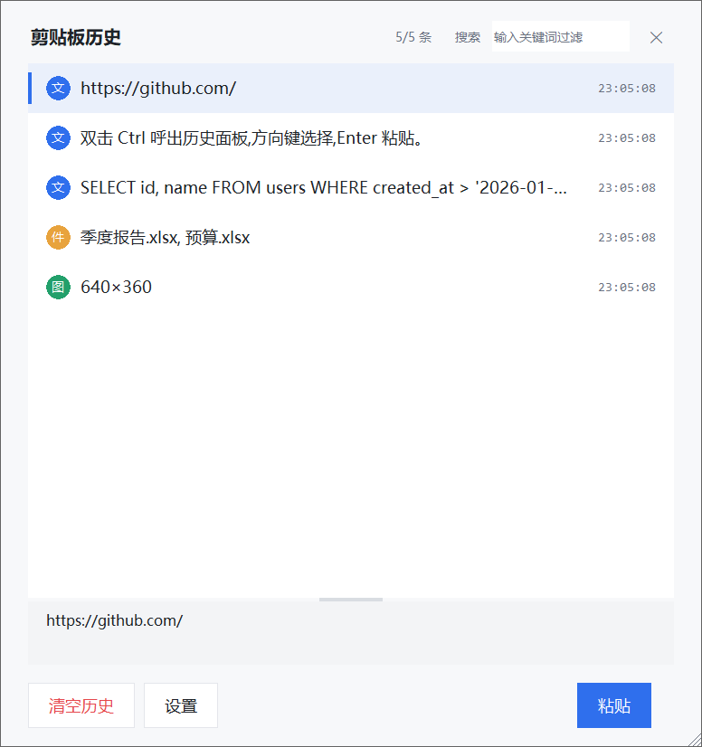

# ClipVault — Windows 剪贴板历史工具

小体量剪贴板管理器:自动记录你复制过的**文本、图片、文件**(最多 100 条),随时粘回。
纯本地运行,**零网络通信**,无任何遥测。



**特性**

- 文本 / 图片(缩略图预览)/ 文件列表三类内容统一管理,超 100 条自动淘汰最旧
- 面板出现在插入光标下方,方向键选择 Enter 粘贴,或双击条目
- 双击 Ctrl 呼出/隐藏,面板可拖动、可缩放,详情区高度可调
- 搜索过滤、一键清空(二次确认)、中英文双语
- 单文件 exe,约 19MB,无外部依赖

## 快速开始

**直接用(推荐)**:从 [Releases](../../releases) 下载 `ClipVault.exe`,双击运行,程序驻留系统托盘(右下角蓝色图标)。

**从源码跑**(需要 Python 3.13+ 的**完整版**,精简版/嵌入式版本不带 tkinter):
```bat
python -m venv .venv
.venv\Scripts\pip install -r requirements.txt
.venv\Scripts\python main.py
```

## 操作方式

| 操作 | 键盘 | 鼠标 |
|------|------|------|
| 呼出/隐藏历史面板 | **双击 Ctrl** | 左键双击托盘图标 / 右键菜单"显示/隐藏面板" |
| 粘贴最新一条 | **Ctrl+Alt+V** | 托盘右键 → "粘贴最新" |
| 面板内选择粘贴 | ↑↓ 移动,**Enter** 粘贴 | 单击选中,**双击**粘贴 |
| 查看完整内容 | 选中条目,下方详情区自动展开全文/缩略图/全路径 | 同左,支持滚轮翻看长文本 |
| 搜索历史 | 点击搜索框(或按 Tab)后直接打字 | 同左 |
| 关闭面板 | Esc | 右上角 ✕ |
| 一键清空 | 面板"清空历史"按钮(有二次确认) | 托盘右键 → "清空历史" |
| 粘贴后行为 | 面板"设置"按钮 → 勾选「粘贴后保持面板打开」即连续粘贴 | 同左 |
| 切换界面语言 | 面板"设置" → 语言:中文 / English(立即生效) | 同左 |
| 调整面板大小 | — | 拖动右下角斜纹热区;拖动列表与详情之间横条调详情区高度 |
| 移动面板 | — | 按住顶栏标题或空白处拖动 |

面板默认出现在**插入光标下方**;下方空间不足时自动翻到光标上方。

## 规则

- 最多存 **100 条**;存满后每新复制 1 条,自动删掉最早的那 1 条
- 连续复制相同内容只记 1 条
- 历史保存在 `%APPDATA%\ClipVault\`,重启电脑不丢
- 单条文本上限 1MB(超出截断),单张图片上限 50MB(超出不记录)

## ⚠️ 隐私与安全须知(使用前必读)

1. **本工具会记录你复制的一切内容,包括密码、验证码、私钥等敏感信息**,以明文存于本机 `%APPDATA%\ClipVault\`。复制敏感内容后如不放心,请用"清空历史"立即清除
2. 为实现"双击 Ctrl 呼出",程序使用全局键盘钩子监听按键——**仅本地判断,不记录、不上传任何按键内容**(代码零网络调用,可自行审查 `hotkeys.py`)
3. 历史文件不会上传、不同步,卸载时删除 `%APPDATA%\ClipVault\` 即可彻底清理

## 自定义

改 `config.py`:热键、容量上限、存储目录都在里面,改完重启程序生效。
界面里的设置(语言、粘贴后行为、面板尺寸)存于 `%APPDATA%\ClipVault\settings.json`,面板内"设置"按钮修改。

## 已知限制

1. 向"以管理员身份运行"的窗口(如部分 IDE/终端)注入 Ctrl+V 可能无效——Windows UIPI 安全限制,所有同类工具一样;可对目标程序降权运行或给 ClipVault 提权
2. 文件粘贴只在支持文件粘贴的目标(资源管理器、对话框等)生效
3. 图片仅支持标准位图格式;Photoshop 等私有剪贴板格式不记录

## 自行打包

双击 `build.bat`(前置条件见脚本内注释),产物在 `dist\ClipVault.exe`。

## 测试

```bat
.venv\Scripts\python tests\test_storage.py
.venv\Scripts\python tests\test_clipboard_roundtrip.py
.venv\Scripts\python tests\test_gui_smoke.py
```

## License

MIT,见 [LICENSE](LICENSE)。
